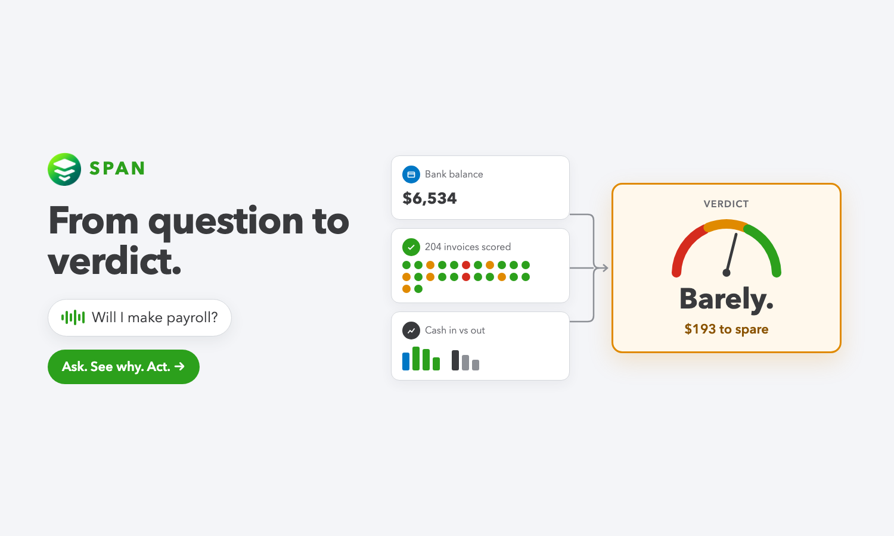
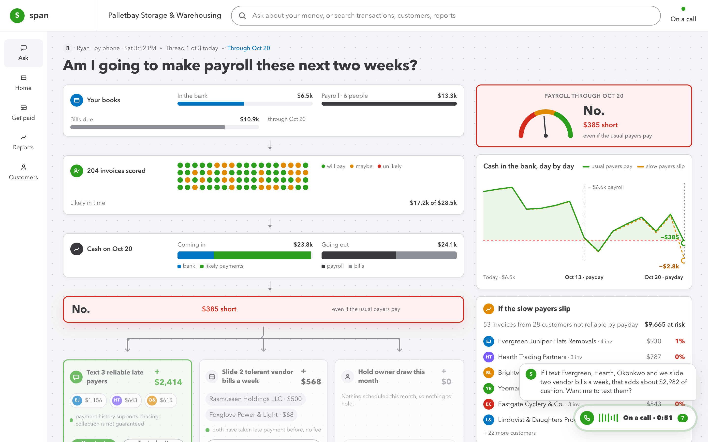
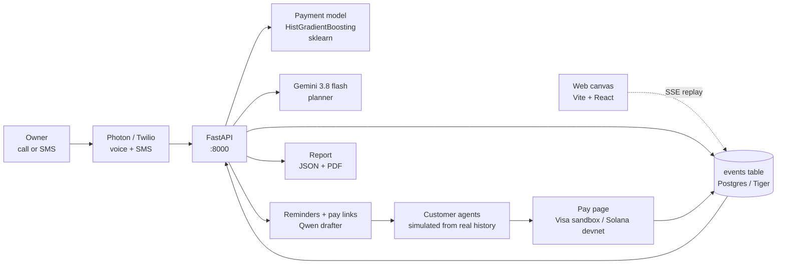

<p align="center">
  
</p>

<h1 align="center">Span</h1>

<p align="center">Call Span. Ask if you'll make payroll. Watch the answer get made.<br/><sub>Built at LA Hacks 2026 on the Intuit QuickBooks hackathon dataset.</sub></p>

<p align="center">
  
  
  
  
  
</p>

Span is a phone number a small-business owner calls or texts to ask *"am I going to make payroll these next two weeks?"* It answers in seconds with real numbers from their books — and while it works, a web page draws its reasoning live as a workflow: pulling context, scoring every open invoice against that customer's payment history, forecasting cash on payday, the answer, the levers that close the gap.

Say yes, and Span texts the right customers, reads their replies, negotiates installments with the customer's agent under the owner's rules, and takes payment through a pay link (Visa sandbox or Solana devnet USDC). The gap on screen ticks down as money lands. When it's done it generates a one-page report — JSON for the frontend, PDF for the accountant.

<p align="center">
  
</p>

<p align="center">
  
</p>

## How it fits together



Every externally visible step emits an event (`node.create`, `node.update`, `decision`, `speech`, `report.ready`). The frontend replays that stream as the reasoning canvas; the report is rebuilt from the same events, so it always matches what was on screen.

## The demo

Demo company: **Palletbay Storage &amp; Warehousing** (`company-020`) — $6.5k in the bank, $13.3k payroll, $10.9k bills due, $28.5k owed by customers. The honest answer is *"No. About $385 short."* One lever — texting Evergreen, Hearth and Okonkwo and sliding two vendor bills — covers it. Evergreen's agent negotiates two $578.10 installments; the first lands on Visa sandbox and the cushion turns green.

- Frontend replays `frontend/public/fixture.json` with original timing; `?live` streams a real run over SSE, `?run=<id>` replays a stored run, `?speed=N` fast-forwards.
- `npm run record` in `frontend/` captures `demo.webm`, six stills and the 1500×900 Devpost thumbnail from that replay — no manual clicking.
- The one-page report lives at `/report/:id`; the same page prints cleanly and links to `/reports/:id.pdf`.

## Stack

- **Backend** — Python 3.12, FastAPI, uv, psycopg → Postgres (TimescaleDB locally, Tiger Cloud in prod)
- **Fast lane** — payment-behavior model trained on all 86 non-POS companies: horizon-CDF classifier + write-off classifier (HistGradientBoosting). Held-out: **MAE 1.25 days**, AUC paid-within-30d 0.968, write-off AUC 0.795 (5-fold CV). Metrics at `/model/metrics`.
- **Planner** — Gemini 3.8 flash picks levers, drafts the spoken answer and writes the report narrative; deterministic templates keep every output working with no key.
- **Rails** — Visa sandbox card + Solana devnet USDC on the pay page; Sentry Tracing on every request and model call.
- **Agents** — Fetch uAgents / Agentverse registration; customer agents are simulated from each customer's real payment history.
- **Frontend** — Vite + React 19, no UI framework; served by FastAPI at `/` in production.

## Run it

```bash
./scripts/fetch_data.sh                 # Intuit 100-company dataset
docker compose up -d db                 # TimescaleDB on :5433
cd backend && uv venv -p 3.12 && uv pip install -e ".[dev]" && cp .env.example .env
.venv/bin/python -m owed.db.load --reset        # ~65 s
.venv/bin/python -m owed.finance.train          # ~15 s
.venv/bin/uvicorn owed.main:app --port 8000     # API

cd frontend && npm install && npm run dev       # canvas on :5173 (demo replay)
```

Production is one `docker compose up` on Vultr — Postgres + API + built frontend + Caddy HTTPS. See [`deploy/README.md`](deploy/README.md).

## Repo

| path | what it is |
|---|---|
| `backend/owed/` | FastAPI app: `planner.py`, `finance/` (queries + model + train), `events.py`, `runs/`, `reports/`, `payments/`, `channels/` (Photon, drafter), `agents/`, `voice/` |
| `frontend/src/` | Canvas (`App.tsx`), event reducer (`events.ts`), `/report/:id` (`Report.tsx`) |
| `frontend/scripts/` | `record_demo.ts` — the demo recorder |
| `docs/api-contract.md` | The contract — every endpoint and event shape |
| `docs/devin/` | Agent task briefs, screenshots, rendered report samples |
| `docs/submission/` | Devpost copy, video script, Sentry bug write-up evidence |

## Disclosure

Customer agents in the demo are simulated from each customer's real payment history in the dataset. No dataset rows were modified. Card payments run in the Visa sandbox; Solana transfers are devnet.
